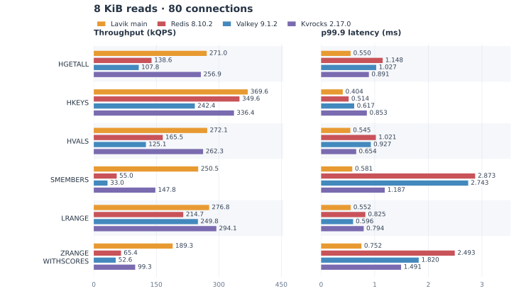
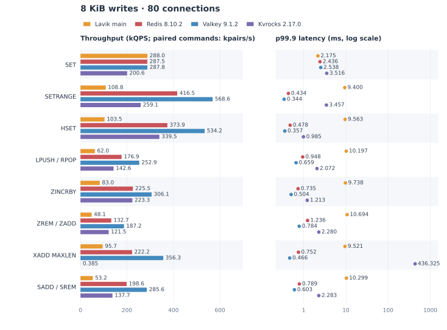

# Lavik main：1 MiB 与 8 KiB 对象测试结果

8 KiB 四库对照已更新为最新 main `6a3d186c` 的同源码版本结果；1 MiB 的 ZINCRBY、ZREM/ZADD 使用刚完成的 #358 优化版结果，其余 1 MiB 项目保留 2026-10-18 的测量。

1 MiB 除两项 ZSet 更新命令外使用 Lavik main [`9c68079`](https://github.com/eloqdata/lavik/commit/9c68079a7dd775db647cf55fe578a6cd43426a82)，2026-10-18（UTC）测量。每组 8,192 keys，每 key 约 1 MiB 用户数据，合计约 8 GiB。服务器为 Azure Standard_L16aos_v4，客户端为 Standard_F32als_v6。

## 四库读写对比

Redis 8.10.2、Valkey 9.1.2、Apache Kvrocks 2.17.0。每格为 **吞吐 / Avg ms / p99.9 ms**。LPUSH/RPOP、ZREM/ZADD、SADD/SREM 的吞吐单位为 pairs/s，其余为 QPS。

| 命令 | 连接数 | Lavik main | Redis | Valkey | Kvrocks |
|---|---:|---:|---:|---:|---:|
| HGETALL | 80 | 2,628.7 / 30.427 / 240.626 | 1,720.0 / 46.495 / 96.314 | 689.5 / 116.002 / 302.107 | 2,439.0 / 32.792 / 57.092 |
| HKEYS | 80 | 4,523.0 / 17.684 / 109.109 | 5,601.0 / 14.280 / 27.669 | 2,451.3 / 32.624 / 34.805 | 8,079.5 / 9.899 / 23.512 |
| HVALS | 80 | 2,730.8 / 29.236 / 221.018 | 2,158.0 / 37.059 / 75.825 | 822.6 / 96.932 / 215.772 | 2,602.3 / 30.735 / 52.471 |
| SMEMBERS | 80 | 2,315.4 / 34.544 / 128.965 | 308.3 / 259.066 / 728.929 | 215.0 / 372.064 / 714.128 | 1,318.2 / 60.658 / 163.870 |
| LRANGE | 80 | 2,733.9 / 29.231 / 222.346 | 2,735.7 / 29.234 / 221.266 | 1,726.8 / 46.321 / 111.248 | 2,734.2 / 29.253 / 231.499 |
| ZRANGE WITHSCORES | 80 | 1,803.6 / 44.316 / 272.043 | 483.5 / 165.247 / 332.377 | 281.8 / 283.844 / 529.133 | 796.7 / 100.334 / 184.425 |
| HGETALL | 1 | 309.2 / 3.233 / 3.985 | 666.0 / 1.500 / 1.669 | 471.6 / 2.119 / 2.358 | 387.3 / 2.580 / 3.052 |
| HKEYS | 1 | 413.1 / 2.418 / 3.179 | 2,551.5 / 0.391 / 0.490 | 1,625.6 / 0.614 / 0.799 | 707.6 / 1.412 / 1.595 |
| HVALS | 1 | 319.8 / 3.125 / 3.934 | 755.4 / 1.322 / 1.448 | 564.5 / 1.770 / 2.036 | 420.6 / 2.376 / 2.893 |
| SMEMBERS | 1 | 209.1 / 4.779 / 6.258 | 198.5 / 5.037 / 7.764 | 166.4 / 6.008 / 6.509 | 128.6 / 7.770 / 9.222 |
| LRANGE | 1 | 469.7 / 2.127 / 2.624 | 976.9 / 1.022 / 1.128 | 1,012.3 / 0.986 / 1.197 | 494.0 / 2.022 / 2.564 |
| ZRANGE WITHSCORES | 1 | 137.4 / 7.273 / 8.272 | 218.6 / 4.573 / 4.807 | 178.3 / 5.606 / 5.993 | 78.1 / 12.806 / 14.876 |
| SET 1 MiB | 80 | 2,257.1 / 35.167 / 304.305 | 2,254.7 / 35.096 / 238.912 | 2,261.4 / 35.086 / 101.105 | 2,254.3 / 35.264 / 236.178 |
| SETRANGE 256 B | 80 | 59,476.0 / 1.344 / 14.838 | 396,780.0 / 0.200 / 0.455 | 547,147.1 / 0.145 / 0.356 | 2,915.7 / 27.428 / 629.401 |
| HSET 256 B | 80 | 81,514.4 / 0.980 / 11.825 | 332,524.6 / 0.239 / 0.546 | 457,388.9 / 0.174 / 0.396 | 219,590.1 / 0.363 / 2.104 |
| LPUSH/RPOP | 80 | 86,390.4 / 0.925 / 16.991 | 172,679.2 / 0.463 / 0.956 | 242,703.9 / 0.329 / 0.679 | 98,230.9 / 0.814 / 3.812 |
| ZINCRBY | 80 | 33,428.9 / 2.392 / 27.017 | 101,069.6 / 0.790 / 1.546 | 110,573.4 / 0.722 / 0.946 | 88,791.1 / 0.900 / 3.112 |
| ZREM/ZADD | 80 | 20,293.9 / 3.940 / 34.061 | 84,178.2 / 0.949 / 1.474 | 100,084.5 / 0.798 / 1.199 | 79,431.8 / 1.006 / 3.320 |
| XADD MAXLEN = 4096 | 80 | 58,377.6 / 1.369 / 18.879 | 184,642.9 / 0.432 / 0.868 | 249,042.5 / 0.320 / 0.572 | 436.3 / 182.842 / 380.228 |
| SADD/SREM | 80 | 45,319.6 / 1.764 / 19.647 | 151,480.1 / 0.527 / 1.089 | 273,871.4 / 0.291 / 0.640 | 82,922.4 / 0.964 / 2.924 |

两项 1 MiB ZSet 更新结果测于 #358 candidate `32bdd6b`（2026-10-19），未在最新 main 上重跑。ZINCRBY 的 60 秒窗口内吞吐有明显下降，表中为整窗汇总。

竞品写入除 SADD/SREM 外采用既有三轮测试各指标的中位数；其余表格结果均为单轮。操作对按完整一对统计，子命令指标保留在原始 JSON 中。测量日期（UTC）和原文件路径见 [SOURCE.json](SOURCE.json) 与 [formal-points.json](formal-points.json)。

## 数据与测量口径

- String 为 1 MiB；Hash/List 为 4,096 × 256 B；Set/ZSet 为 32,768 × 32 B；Stream 为 4,096 条 entry，每条含一个 256 B payload。HKEYS 只返回字段名，整读返回的协议字节数并不相同。
- main 与本轮 peer 整读预热 60 秒、正式 60 秒；main 写入预热 90 秒、正式 60 秒。80 连接用 16 个客户端线程，1 连接用 1 个线程，pipeline 1，各一轮。正式 CPU/NIC 观察窗口为其中 45 秒。
- main 整读在装载后干净重启；peer 每个数据类型重新启动空库，装载和测量保持同一个进程。Redis/Valkey 关闭周期 RDB 和 AOF，Kvrocks 保持后台 compaction。原 1 MiB main 写入每项独立装载，在同一进程内预热和测量；更新的两项 ZSet 使用共享数据交叉测试。
- 历史 peer HGETALL/ZRANGE/SMEMBERS 的 80 连接结果、Redis LRANGE 的 1 连接结果来自 10 月 16 日，预热 90 秒。历史 Hash 数据编码/客户端与新整读不同；Redis LRANGE 沿用相同客户端源码但二进制不同，且其 warm/formal seed 为 10180/20180；新 1 连接使用 10101/20101。各点的原命令和客户端 SHA 已保留。
- 整读延迟包含网络接收、RESP 解析与完整回复校验，不是纯服务端 CPU 时间。跨日期和客户端口径差异应与性能数值一并阅读。

## peer 写入参照

表中竞品的七组写入取自 [v0.1.0 大对象归档](../lavik-v0.1.0-large-objects-2026-10-14/README.md)：三家 peer、每项三轮，80 连接共 63 个正式原始点，采用 30 秒起的自适应预热；吞吐、平均延迟与 p99.9 分别取三轮中位数。本目录另保留 10 月 16 日三家的 SADD/SREM 单轮结果。

## 原始数据

- [formal-points.json](formal-points.json)：59 个正式点，含 20 个历史 main 点、36 个 peer 整读点和 3 个 peer SADD/SREM 参照点；含指标、命令与原文件路径。
- [SOURCE.json](SOURCE.json)：来源、筛选规则、历史参照及验证文件 SHA。原始结果、运行命令、客户端源码、CPU/NIC 记录、配置和日志按来源目录存放。
- [SHA256SUMS](SHA256SUMS)：发布内容校验和。操作对状态二进制留在本地，仅发布其 SHA 和原状态清单。

目录名保留以维持已有链接；内容对应上述 main 提交与实际测量日期。

## 8 KiB 四库读写对比（2026-10-19）

Lavik main [`6a3d186c`](https://github.com/eloqdata/lavik/commit/6a3d186ce3ea1c1d8b06eeed7da09dc2a91cdb65)、Redis 8.10.2、Valkey 9.1.2、Apache Kvrocks 2.17.0。服务器为 Azure Standard_L16aos_v4，客户端为 Standard_F32als_v6。每项独立装载 **8,192 keys × 8 KiB 用户数据**，合计 64 MiB；**80 连接、16 个客户端线程、pipeline 1**，预热 90 秒、正式测量 60 秒，各一轮。

每格为 **吞吐 / Avg ms / p99.9 ms**。LPUSH/RPOP、ZREM/ZADD、SADD/SREM 的吞吐单位为 pairs/s，其余为 QPS。Lavik 实测提交为 `d0084f4a`（#358 + #357），完整 Git 源码树与上述 main 一致，直接复用这轮结果。实际测量提交和二进制身份保留在原始数据中。

| 命令 | Lavik main `6a3d186c` | Redis 8.10.2 | Valkey 9.1.2 | Kvrocks 2.17.0 |
|---|---:|---:|---:|---:|
| HGETALL | 271,746.8 / 0.294 / 0.537 | 138,608.7 / 0.577 / 1.148 | 107,829.1 / 0.741 / 1.027 | 256,931.5 / 0.311 / 0.891 |
| HKEYS | 365,185.1 / 0.219 / 0.414 | 349,623.0 / 0.228 / 0.514 | 242,446.4 / 0.329 / 0.617 | 336,377.3 / 0.237 / 0.853 |
| HVALS | 267,529.5 / 0.298 / 0.548 | 165,529.8 / 0.483 / 1.021 | 125,095.5 / 0.639 / 0.927 | 262,276.7 / 0.304 / 0.654 |
| SMEMBERS | 250,111.7 / 0.319 / 0.578 | 55,028.5 / 1.453 / 2.873 | 33,008.9 / 2.423 / 2.743 | 147,763.2 / 0.541 / 1.187 |
| LRANGE | 278,155.1 / 0.287 / 0.528 | 214,683.1 / 0.372 / 0.825 | 249,831.8 / 0.319 / 0.596 | 294,097.8 / 0.271 / 0.794 |
| ZRANGE WITHSCORES | 191,515.9 / 0.417 / 0.720 | 65,386.0 / 1.222 / 2.493 | 52,571.8 / 1.521 / 1.820 | 99,322.3 / 0.804 / 1.491 |
| SET 8 KiB | 287,971.2 / 0.275 / 2.175 | 287,477.3 / 0.276 / 2.436 | 287,818.8 / 0.276 / 2.538 | 200,608.7 / 0.396 / 3.516 |
| SETRANGE 256 B | 108,760.6 / 0.734 / 9.400 | 416,530.3 / 0.191 / 0.434 | 568,578.9 / 0.139 / 0.344 | 259,062.7 / 0.308 / 3.457 |
| HSET 256 B | 103,491.4 / 0.772 / 9.563 | 373,935.1 / 0.213 / 0.478 | 534,227.7 / 0.148 / 0.357 | 339,452.5 / 0.234 / 0.985 |
| LPUSH/RPOP | 61,985.7 / 1.290 / 10.197 | 176,945.2 / 0.451 / 0.948 | 252,946.2 / 0.315 / 0.659 | 142,585.6 / 0.560 / 2.072 |
| ZINCRBY | 83,016.6 / 0.962 / 9.738 | 225,544.9 / 0.353 / 0.735 | 306,119.3 / 0.260 / 0.504 | 223,283.6 / 0.357 / 1.213 |
| ZREM/ZADD | 48,136.4 / 1.661 / 10.694 | 132,686.3 / 0.602 / 1.236 | 187,195.8 / 0.426 / 0.784 | 121,514.4 / 0.657 / 2.280 |
| XADD MAXLEN = 32 | 95,729.9 / 0.834 / 9.521 | 222,169.8 / 0.358 / 0.752 | 356,271.1 / 0.223 / 0.466 | 385.1 / 206.991 / 436.325 |
| SADD/SREM | 53,172.1 / 1.504 / 10.299 | 198,620.8 / 0.402 / 0.789 | 285,571.4 / 0.279 / 0.603 | 137,651.1 / 0.580 / 2.283 |





写命令的 p99.9 跨越三个数量级，右侧使用对数刻度的点图；左侧吞吐仍为线性柱状图。

Kvrocks 的 XADD MAXLEN 在正式窗口内仍继续降速：前 10 秒平均 431.7 QPS，最后 10 秒为 346.1 QPS。表中保留该窗口的汇总值，并非稳定平台值；[逐秒数据](objects8k-fourdb-20261019/client/results/kvrocks-stream-c80/result.json)与其余原始结果一起归档。

### 8 KiB 数据与测量口径

- String 为 8,192 B；Hash/List 为 32 × 256 B；Set/ZSet 为 256 × 32 B；Stream 为 32 条 entry，每条含一个 256 B payload。字段名、score、stream ID 和协议编码不计入用户 payload。
- SET 覆盖整个 String；SETRANGE 随机替换 256 B；HSET 随机替换一个已有字段。LPUSH/RPOP 每对增加并取出一个 256 B 元素。ZINCRBY 随机选择成员并加上 ±32768；ZREM/ZADD 和 SADD/SREM 使用每连接独占的成员槽位。XADD 使用精确 `MAXLEN = 32`。
- 每项使用独立数据和服务进程，装载、预热、正式测量之间保持同一进程。操作对在预热和正式阶段连续保存成员状态；延迟按完整操作对计，两个子命令的指标另存于原始 JSON。
- Redis/Valkey 关闭周期 RDB 和 AOF；Kvrocks 关闭 WAL。各数据库实际配置、启动命令和版本标识保留在归档中。
- 整读延迟包含接收、解析与完整回复校验；HKEYS 只返回字段名，返回的协议字节数与其他整读不同。CPU/NIC 观察窗口为正式阶段中的 45 秒。装载、预热、正式阶段分别使用随机种子 101、10180、20180。
- 本组 ZSet 的 compact 编码为 11,272 B，低于 16 KiB 提升阈值；装载、预热和正式测量均未观察到 grouped 写提交。历史 1 MiB 组使用不同 main 提交和测量条件，尺寸间差异不能单独归因于 grouped 编码。

### 8 KiB 运行与原始数据

当前 Lavik 结果与对照库结果分别来自以下运行入口：

```sh
cd /opt/benchmark/compact-pr357-stack-20261019
sudo python3 suite.py lavik
cd /opt/benchmark/objects8k-fourdb-20261019
sudo python3 run.py peers
```

- [运行接口](objects8k-fourdb-20261019/client/runtime-interface.md)与[客户端接口](objects8k-fourdb-20261019/client/clients/client-interface.md)说明装载、采样和执行顺序。
- [当前 56 个对照点](main-report-refresh-20261019/objects8k-reviewed-rows.json)：14 个 Lavik 点来自 [本轮实测](compact-pr357-stack-20261019/)，42 个竞品点来自 [四库归档](objects8k-fourdb-20261019/)。原始命令、配置与日志一并保留。
- [客户端源码](objects8k-fourdb-20261019/client/clients/)、[编译身份](objects8k-fourdb-20261019/client/client-build-manifest.json)、[41 项 Linux fake RESP 验证](objects8k-fourdb-20261019/client/linux-client-tests.json)。
- [当前选点与版本对应](main-report-refresh-20261019/selection.json)及[图表数值校验](main-report-refresh-20261019/chart-receipt.json)；[formal-points.json](formal-points.json) 保留全部历史点及 `current_report_selection`。
