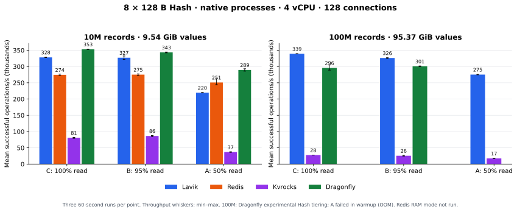
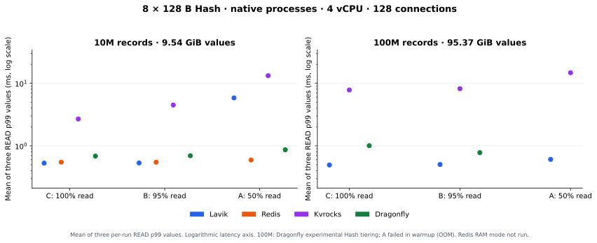

# Native 4-vCPU Hash YCSB comparison · 2026-11-18

> **Backend correction / 后端更正（2026-11-18）:** All Lavik values and figures below are historical **Minimal / io_uring**, not SPDK. Requested **Standard / SPDK** measurements are incomplete (10M C/B completed; A interrupted; 100M not started). Do not treat these tables as an SPDK comparison. See [fio diagnosis and SPDK evidence / fio 排查与 SPDK 证据](fio-diagnostics/).

Status: 10M peer data and Lavik C updated to the current allocation. Lavik 10M B/A tuning is paused; 100M peers have been rerun; Lavik 100M retains the original campaign.

This experiment compares Lavik v0.3.0, Apache Kvrocks 2.17.0, Dragonfly v2.1 and Redis 8.10.3. All run as native processes, one at a time on the same Azure server. No container measurements enter the formal results.

## Archived results before the SPDK correction

The 10M table now uses the current-allocation rerun: all three peers and Lavik read-only. Lavik B/A remain pending: the existing-data retest completed, but NVMe latency instability persisted. See [tuning and excluded evidence](tuning-retry/). Original values remain in [original-results.json](metadata/original-results.json); the prior full report is preserved in Git history. Kvrocks/Dragonfly100M now use the [current large-peer rerun](large-peers-repeat/). Lavik100M retains the earlier allocation. The100M table therefore mixes acquisition periods and is not a controlled same-allocation Lavik-versus-peer comparison.

Each value is the mean of three 60-second runs. C=pure read;B=95%read;A=50%read. P99.9 is the mean of per-run percentiles. [Current data](metadata/results.csv) · [same-host raw evidence](same-host-repeat/)

### 10M records

| Product | C ops/s | B ops/s | A ops/s |
|---|---:|---:|---:|
| lavik (io_uring) | 361,874 | Tuning pending | Tuning pending |
| redis | 258,913 | 259,192 | 233,519 |
| kvrocks | 85,015 | 77,598 | 34,664 |
| dragonfly | 340,929 | 330,934 | 277,608 |

### 100M records

| Product | C ops/s | B ops/s | A ops/s |
|---|---:|---:|---:|
| lavik (io_uring, earlier allocation) | 339,188 | 326,137 | 275,124 |
| redis | Not run | Not run | Not run |
| kvrocks | 23,078 | 21,904 | 14,733 |
| dragonfly | 230,138 | 220,682 | Warmup OOM |

At 10M, Lavik read-only is 361,874 ops/s versus Dragonfly340,929 ops/s (+6.14%). This ranking applies to the current allocation; the original allocation had the opposite ranking. The current Lavik C sample has zero observed active defrag; it is retained while only B/A are tuned.

At100M, the current peer rerun yielded five valid points and a Dragonfly A warmup OOM. See the [large-peer report](large-peers-repeat/) for all15windows and latency results. No new relative Lavik speed claim is made across the different allocations.





## Protocol

- Server: Azure `Standard_L4aos_v5`, East US zone 3; 4 vCPUs / 32 GiB, AMD EPYC 9V45, local NVMe, Ubuntu 24.04 image `Canonical:ubuntu-24_04-lts:server:24.04.202610250`, Linux 7.0.0-1017-azure. The topology is two physical cores with two threads/core, not four physical cores.
- Client: separate `Standard_L16aos_v5` in the same zone and private subnet; 16 vCPUs. Retail compute quotes at preparation: $0.610/hour server and $2.438/hour client; disks and network excluded.
- Datasets: 10M and 100M configured records, each with eight 128-byte field values. Logical field-value payloads are 9.537 and 95.367 GiB; keys, field names and overhead are additional.
- YCSB: `eloqdata/YCSB` commit `247a2d448ebceff11a570a622c49ece161a27ed3`. Use the **Redis binding for all four products**, `redis.scanindex=none`, uniform keys, full-field reads/updates, no scans, no TTL, no pipeline.
- Commands: `HMSET` loads/updates eight fields; `HGETALL` reads all fields. No `_indices` sorted set or index maintenance; no Lavik-specific replacement command.
- Concurrency: 128 business connections, one per YCSB worker, for loading, warmup and measurement; one additional persistent control/sampling connection. All formal runs are unlimited; no target-rate option is passed to YCSB.
- Workloads A/B/C: 50/50 read/update, 95/5 read/update, and read-only. Products run sequentially. Each product/dataset runs in C/B/A order; the schedule is archived.
- Before Kvrocks read-only measurements, confirm post-load compaction has completed. The reproduction controller waits for three consecutive 10-second INFO samples with zero running/pending compactions and estimated compaction debt. This uses no key-count command or key scan.
- Each point: 60-second warmup, then **three independent 60-second measured runs**, fresh JVM per run, including its own JIT/ramp-up. Report the arithmetic mean of three successful QPS values plus all individual values. Any averaged latency quantile is explicitly the mean of three per-run percentiles, not a pooled percentile.
- A/B/C update existing keys and do not insert new records during measurements. All-field values remain 128 bytes.
- Native thread settings: Lavik `--threads 4`; Redis `--io-threads 4` (confirmed via live `CONFIG GET`); Kvrocks `workers 4`; Dragonfly `--proactor_threads=4`. Redis I/O threading does not turn the tested commands into parallel command execution.
- Memory: each service cgroup has `MemoryMax=28G`, `MemorySwapMax=0`; engine limits are 24 GiB where available. Kvrocks uses an 8 GiB block cache. Four CPUs cover each service and its background threads. Eviction and swap are disabled.
- Primary memory baselines have AOF and scheduled snapshots disabled. Native storage engines retain documented storage maintenance. These configurations do **not** establish equal power-loss durability.

10M is the common in-memory-sized comparison. At 100M, run Lavik, Kvrocks and explicitly labeled Dragonfly experimental Hash tiering (`--tiered_prefix`, `--tiered_experimental_hash_support=true`, `--listpack_max_field_len=256`, and `--listpack_max_bytes=2048`). Verify that actual offloading occurs. Redis in-memory mode cannot be treated as a complete-dataset throughput comparison when it cannot retain the full dataset. Do not silently substitute caching/eviction or a smaller dataset.

Seven feasible product/configuration/dataset pairs × three workload points × (60-second warmup + three 60-second runs) is 1.4 hours before loading and setup. One-minute windows do not establish long-term compaction or cleaning steady state. Product order is fixed, and repetitions are consecutive; disclose that limit.

## Native builds and deployment

`build-native.sh` builds Redis and Kvrocks on the client outside measurement windows. It records binary SHA-256s, version strings and dynamic-library dependencies. Lavik uses the SHA-256-verified v0.3.0 x86_64 minimal release archive; Dragonfly uses its v2.1 x86_64 release archive. Record archive SHA-256s for both.

Use `provision-azure.sh` with your own `PUBLIC_KEY_FILE` and `ADMIN_CIDR` to provision a fresh resource group. Install native dependencies with `install-deps.sh` as root on each host. The verified empty local NVMe was formatted as ext4 with `lazy_itable_init=0,lazy_journal_init=0` before mounting, outside all measured windows. Apply `swapoff -a`, `vm.overcommit_memory=1` and THP `never` consistently before acquisition.

`download-native.sh` installs the two official native release archives on the server. After checking `lsblk` and confirming that the selected device is the new empty Azure local NVMe, run `prepare-storage.sh` as root with `BENCH_DEVICE` set explicitly. It rejects mounted disks, existing signatures and non-direct-NVMe models. `host-policy.sh` applies the server policy. The actual scratch device in this acquisition was `/dev/nvme1n1`, 2,879,775,571,968 bytes.

Copy the client-built `native-bin/redis-server`, `native-bin/kvrocks`, and `native-bin/kvrocks.conf` to the server. Place the executables in `/opt/bench/bin/` and copy `kvrocks.conf` to `/opt/bench/kvrocks-default.conf`. Record hashes after transfer. The dedicated server expects executables and configuration at:

```
/opt/bench/bin/redis-server
/opt/bench/bin/kvrocks
/opt/bench/kvrocks-default.conf
/opt/bench/lavik-release/lavik-v0.3.0-linux-x86_64-minimal/lavik
/opt/bench/dragonfly-release/dragonfly-x86_64
```

The server's verified empty local NVMe is mounted as `/mnt/bench`. `server-control.py` creates fresh per-dataset directories, starts native systemd services, records exact launch arguments, and rejects starting a peer while another database is active. Lavik's new file is a sparse 512 GiB storage file. Reproduction must identify its own empty scratch device; these scripts do not format a disk.

On the Linux client, install Java 17, Maven, Python 3 plus `python3-redis`, SSH, and sysstat. Stage the source checkout:

```bash
curl -fL https://codeload.github.com/eloqdata/YCSB/tar.gz/247a2d448ebceff11a570a622c49ece161a27ed3 -o ycsb-source.tar.gz
mkdir -p /opt/bench/YCSB-247a2d4
tar -xf ycsb-source.tar.gz --strip-components=1 -C /opt/bench/YCSB-247a2d4
cd /opt/bench/YCSB-247a2d4
mvn -B -Psource-run -pl site.ycsb:redis-binding -am clean package
```

Place `run.py`, `verify.py`, `common.properties`, and `campaign.py` under `/opt/bench/kit/`. Put `server-control.py` and `capture-server.py` on the server under `/opt/bench/`. Adapt the private server address (`10.83.0.4`), SSH account and paths before reproduction. The client's `/opt/bench/server-key` must be a locally supplied private key authorized for the dedicated benchmark server; no private key is published.

Preview a single run:

```bash
python3 /opt/bench/kit/run.py --ycsb-root /opt/bench/YCSB-247a2d4 \
  --host 10.83.0.4 --product lavik --records 10000000 \
  --phase measure --workload B --threads 128 --target 0 \
  --seconds 60 --label n10m-B-unlimited-r1
```

The default only prints the command. Add `--execute` to run after a valid load. `--target 0` removes throttling. `campaign.py` implements the full sequential schedule and controls the server over SSH. The large `operationcount=2000000000` is a non-binding cap; `maxexecutiontime=60` controls each measurement. The YCSB progress line may estimate hours to reach that operation cap; this is not the configured run duration. Each invocation records exact arguments, complete YCSB output, HDR logs, status counts and successful QPS. A failed worker or absent complete measurements invalidates a run even if the Java launcher exits zero.

## Validation without key-count scans

**No `DBSIZE`, `DBSIZE SCAN`, `KEYS`, or `SCAN` runs after loading.** Check the exact successful INSERT count from the YCSB load receipt, then use `verify.py` to probe fixed/distributed keys generated with the same YCSB FNV key naming. Check 1,003 samples for exactly eight expected fields and 128-byte values, retain per-key hashes, and check that `_indices` is absent. Recheck field shape after each point.

Configured record count and successful load operations are not an independently measured exact server key count. Preserve that distinction in results. Formal runs require zero failed statuses, worker exceptions and missing reads. Retain unsuccessful runs separately.

Record ordinary latency statistics and retain intended-start histograms as emitted by YCSB. Report actual successful QPS; there is no target-rate attainment comparison. Capture client/server sysstat, cgroup CPU/memory/I/O counters and engine INFO snapshots outside measured windows.

## Evidence layout

- `scripts/`: executable reproduction sources and common properties.
- `metadata/`: source lock, sanitized environment and normalized measurements.
- `raw/raw.tar.xz.part-*`: split archive of formal native load/warmup/measured logs, HDR histograms, sampling receipts and telemetry. Concatenate before extracting.
- `SHA256SUMS`: checksums of checked-in evidence; created when packaging.

Credentials, SSH keys, database files and earlier container pilot results are excluded. The original campaign contains60 valid measured windows; current table provenance is recorded per row in metadata/results.json. Both failed Dragonfly attempts and the excluded Kvrocks post-load-compaction attempt remain in the raw archive.

## Protocol update

The user removed all rate-limited tests before the final campaign. Earlier mixed-rate logs are excluded. The final unlimited-only campaign starts each product/dataset from a fresh load, avoiding write-history differences introduced by the interrupted protocol. The original completed read-only unlimited point is preserved as a superseded observation, outside the final mean tables. Formal outputs live under `/opt/bench/formal-unlimited-native`.

## Kvrocks readiness correction

The initial 100M Kvrocks read-only triplicate overlapped post-load compaction (three active jobs were observed). Those logs and snapshots are retained under `excluded-postload-compaction/` and excluded from the final comparison. The controller was paused, the existing complete dataset was retained, and the read-only triplicate was repeated only after compaction quiescence. A new pre-C field/hash sample records the baseline after the interrupted short B warmup. The 10M Kvrocks before-C snapshot already showed zero running/pending compaction. `campaign.py --resume` resumes validated persistent datasets and skips completed configurations; it does not repeat the 100M bulk load.

## Dragonfly tiering eligibility correction

The initial tiered load used default hash encoding thresholds and returned `ERR Out of memory` after the last progress receipt of 13,571,474 insert operations. Those logs are preserved under `excluded-tiering-default-encoding/`; no complete load count or throughput point is inferred from that failure. The 8 × 128 B schema exceeds default listpack thresholds of 64 B per field/value and 1024 B total. The final large Dragonfly group explicitly permits 256 B fields/values and 2048 B total, as required to keep these hashes eligible for experimental tiering. Logical data and CPU/memory budgets are unchanged. The 10M RAM baseline retains default encoding settings, so Dragonfly capacity-retention comparisons also change configuration and must be labeled accordingly. Reference: [Dragonfly Hash tiering configuration](https://www.dragonflydb.io/blog/ssd-data-tiering-is-generally-available).

After acquisition, Dragonfly is stopped with `SHUTDOWN NOSAVE` to avoid generating an unnecessary large snapshot of disposable test data. This happens after acquisition (after the recorded warmup failure in the incomplete Dragonfly group); it changes no timed workload.

## Inspecting and reproducing the evidence

Concatenate the twelve byte-exact archive parts under `raw/` to reconstruct `raw.tar.xz` (24,000,032 bytes; SHA-256 `1bd5bd731de1575b73691b3e60f9dbe796a7e6d6d2132a9e84026cb10a1297ae`). The archive extracts into `raw/`, including `formal-unlimited-native/`, client toolchain/build/sysstat provenance, and server launch arguments, human logs and telemetry. `metadata/raw-manifest.json` gives uncompressed file byte counts and SHA-256s. No database files or private keys are included.

```bash
sha256sum -c SHA256SUMS
cat raw/raw.tar.xz.part-* > raw.tar.xz
echo "1bd5bd731de1575b73691b3e60f9dbe796a7e6d6d2132a9e84026cb10a1297ae  raw.tar.xz" | sha256sum -c -
tar -xJf raw.tar.xz
python3 scripts/verify-evidence.py raw/formal-unlimited-native --out audit.json
python3 scripts/plot.py audit.json --out figures-reproduced
```

The auditor against the original raw archive reports20 valid points/60 windows;the same-host peer archive reports9 points/27 windows. Current tables select the latest declared campaign per row. A recorded expected failure is reported separately from successful measurements; it is not silently discarded. Install Matplotlib to regenerate figures.

The benchmark does not exhaustively sweep connection counts, equalize durability, measure recovery, or demonstrate multi-hour cleaning/compaction steady state. Use the exact logged launch configurations and preserved exclusions when interpreting these results.
