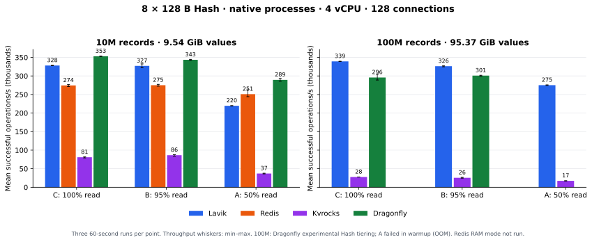

# 4 vCPU Hash YCSB 实测结果

已完成20个有效点、60个一分钟窗口；每点先预热一分钟，再独立运行三次一分钟，取成功操作吞吐的算术平均值。另有 Dragonfly 1亿条 A 点在预热阶段返回 `ERR Out of memory`，没有有效测量窗口。

服务端 Azure L4aos_v5，4 vCPU（2物理核/SMT）、32GiB、本地NVMe；独立16 vCPU客户端；128个业务连接。所有产品原生部署、逐个运行；无限速、无pipeline、关闭YCSB索引。数据为8个128字节字段，HGETALL读取、HMSET全字段更新。Redis启用 `io-threads=4`，已通过运行中CONFIG GET确认。灌数后没有执行DBSIZE或键扫描。

单位：成功操作/秒；C纯读，B读95%/写5%，A读写各半。

| 数据量 | 产品 | C | B | A |
|---|---|---:|---:|---:|
| 1000万 | lavik | 328,039 | 327,105 | 219,514 |
| 1000万 | redis | 274,364 | 274,942 | 250,907 |
| 1000万 | kvrocks | 80,875 | 86,442 | 36,984 |
| 1000万 | dragonfly | 352,966 | 343,363 | 289,383 |
| 10000万 | lavik | 339,188 | 326,137 | 275,124 |
| 10000万 | redis | 未运行 | 未运行 | 未运行 |
| 10000万 | kvrocks | 27,676 | 25,541 | 17,317 |
| 10000万 | dragonfly（实验性Hash分层） | 295,738 | 300,814 | 预热OOM |

1亿条时，Lavik相对Kvrocks的C/B/A吞吐分别为12.26/12.77/15.89倍；相对Dragonfly分层的C/B高14.69%/8.42%。1千万条时Dragonfly三个点均更快，Redis的A也快于Lavik。结果说明Lavik在本次超内存容量场景有优势，不能推广为所有场景都更快。

Redis内存模式没有运行1亿条：仅字段值就95.37GiB，超过32GiB服务器；这不是一次实际测得的Redis OOM。Dragonfly大数据量启用了实验性Hash分层，且调整listpack阈值使8×128B记录可下沉，不能把其大小数据量结果当作完全相同配置的容量曲线。

原始记录保留了Kvrocks等待灌数后压实完成再重测的过程，以及Dragonfly默认编码阈值导致下沉失败的早期尝试。它们没有混入最终均值。三次一分钟不能代表长期清理、压实稳态；各引擎持久化保证也没有等同。

[英文完整报告与复现步骤](README.md) · [独立审计结果](metadata/results.json) · [逐次吞吐与延迟CSV](metadata/results.csv)

