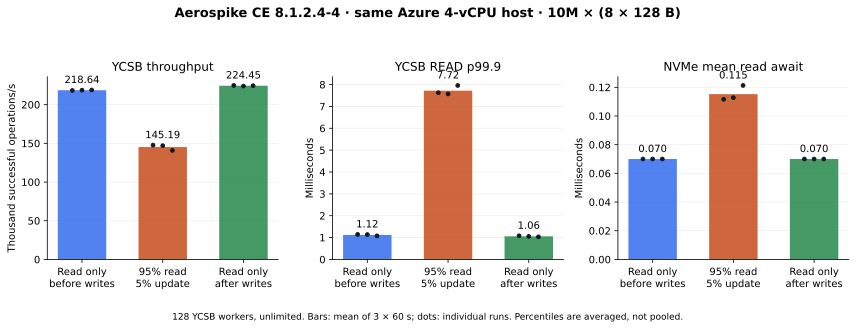

# Mixed-I/O diagnosis: fio, direct SPDK and Aerospike

**[中文结论](README.zh-CN.md)** · 2026-11-18 · same still-running Azure allocation

**The read slowdown is now reproduced outside Lavik, through both Linux io_uring and a standalone SPDK program.** Small random reads remain fast alone but slow sharply with only about 5 MiB/s of writes. This supersedes the narrower conclusion of [the first fio matrix](../fio-diagnostics/), whose different I/O shapes did not reproduce it. It does not invalidate those earlier measurements.

The evidence localizes a reproducible problem to the NVMe completion path under these conditions, independent of Lavik's coroutine scheduling or defrag. It does **not** identify a failed physical SSD, establish which Azure backend component is responsible, or prove that all instances of this VM family behave identically. A kernel 4-KiB-aligned counterexample below prevents claiming that 4 KiB alignment is a universal fix. No Lavik source patch has been deployed or validated by these tests.

## Aerospike on the same device

Native Aerospike CE **8.1.2.4-4**, matching the version in the referenced Lavik v0.2.0 comparison. Same server: 4 vCPU / nominal 32 GiB, CPUs 0–3, ordinary-memory cgroup limit 28 GiB, swap disabled for the service. Independent 16-vCPU client. No containers or simultaneous databases. Storage parameters remain at server defaults; only cluster/listener/namespace/replication/device settings are changed. The raw partition is 512 GiB, within CE's node-capacity limit, on the same local NVMe. This preparation replaced the previous Lavik data; all evidence remains on the separate OS disk.

Fresh load: exactly **10,000,000 successful INSERTs**, eight 128-byte bins per record. 1,003 distributed key samples with SHA-256 field digests matched across clean stop/restart. Final sample validation also passed. YCSB commit `247a2d448ebceff11a570a622c49ece161a27ed3`, unmodified Aerospike binding / Java client 3.1.2; all-bin reads and all-bin `REPLACE_ONLY` updates. Uniform keys, 128 synchronous YCSB workers, unlimited rate. The observed peak was **257 total server client connections**, including driver management and monitoring connections; this is not 128 total TCP connections.

Sequence: C warmup → C ×3 → B warmup → B ×3 → C-recovery warmup → C-recovery ×3. Every warmup and measurement lasts 60 seconds, in a fresh JVM. Means below are arithmetic means of three measurements; p99.9 values are averaged per-run percentiles, not pooled percentiles. All nine measured windows have zero client errors, and server read/write success-counter deltas match the client counts exactly. Server defrag read/write counters did not increase in any measured window.

| Phase | Mean successful ops/s | READ mean (ms) | READ p99.9 (ms) | NVMe read await (ms) |
|---|---:|---:|---:|---:|
| C: read only before updates | 218,644 | 0.583 | 1.120 | 0.070 |
| B: 95% read / 5% update | 145,195 | 0.886 | 7.719 | 0.115 |
| C: read only after updates | 224,445 | 0.568 | 1.056 | 0.070 |

B throughput is 33.59% lower than initial C; READ p99.9 is 6.89× higher. Performance recovers after updates stop. **Aerospike also exhibits mixed-workload degradation, but not the same sustained ~1.6 ms mean device-read wait seen in the Lavik investigation.** These results alone cannot attribute every lost operation or every tail-latency outlier to the device: normal write work, server queues, caching and different I/O concurrency also matter.



Effective settings and measured I/O explain why “both batch writes” does not mean identical disk traffic:

- Aerospike detects a **512-byte minimum I/O**. Its device reads average **1.625 KiB**.
- Aerospike defaults: `flush-size=1048576`, `flush-max-ms=1000`, `post-write-cache=268435456`, `read-page-cache=false`, `commit-to-device=false`, `service-threads=20` on this four-CPU host. These values were read back, not inferred. Successful responses are not equivalent to a synchronous disk-commit guarantee.
- During B, device writes average **256 KiB**, **33.16 IOPS**, **8.29 MiB/s**, and **2.166 ms** write await. Application-level 1 MiB flush units are distinct from device requests.
- The earlier Lavik SPDK B trace completed about **53 KiB per write** and **1.76 KiB per read** on average. Lavik's full-field HMSET and Aerospike's REPLACE_ONLY are different command semantics; the former can require reading the existing value. Do not turn this diagnostic into an equal-durability or identical-I/O product ranking.

[I/O-aligned Aerospike data](aerospike-results.csv) · [full per-run data](aerospike-results.json). Iostat is averaged over full one-second intervals inside the YCSB-reported window; await is request-count-weighted within each run. It measures queueing plus completion latency, not pure flash service time or request percentiles.

## Independent I/O reproduction

Each point has three 60-second measurement windows following a five-second ramp. No I/O errors were reported in the **27 additional windows**. Read region: offset 1 GiB, length 8 GiB of the previously loaded Lavik device. Write region: the dedicated scratch range starting at 2 TiB. No other database ran during these probes.

The standalone SPDK “small” case chooses 1,536/2,048-byte reads at approximately 56%/44%. fio job files request the same split, but raw bytes/completion counts show effective reads of approximately **1,536 bytes** with this fio configuration; the fio cases must not be interpreted as delivering the requested two-size mix. Offsets are 512-byte aligned unless specified. Four readers, depth 32 each, total read depth 128. fio 3.36 uses native io_uring with direct I/O. Its writer is one job, depth 4, sequential 53,248-byte writes at 5 MiB/s; the unaligned-write treatment uses 53,760 bytes instead. The SPDK probe has four pinned workers and one qpair per worker; each has 32 reads and at most one concurrent sequential write, at 1.25 MiB/s per worker. The SPDK read/write queues therefore differ from fio's layout.

| Backend / case | Mean read IOPS | Mean read latency (µs) | Run IOPS min–max |
|---|---:|---:|---:|
| fio small read only | 431,417 | 294.9 | 431,417–431,417 |
| fio small reads + aligned writes | 70,502 | 1,814.8 | 69,312–72,416 |
| fio small reads + unaligned writes | 69,872 | 1,830.8 | 68,680–70,715 |
| fio small reads, 4 KiB offset alignment + writes | 78,903 | 1,620.9 | 78,358–79,691 |
| fio 4 KiB reads, 512 B offset alignment + writes | 59,997 | 2,132.4 | 59,123–61,081 |
| fio 4 KiB reads, 4 KiB offset alignment + writes | 200,678 | 1,096.7 | **84,788–431,220** |
| direct SPDK small read only | 431,431 | 296.6 | 431,430–431,431 |
| direct SPDK small reads + writes | 71,640 | 1,786.6 | 71,292–71,865 |
| direct SPDK 4 KiB aligned reads + writes | 431,231 | 296.7 | 431,231–431,231 |

The **kernel fully aligned case** ran at 431,220 / 86,027 / 84,788 IOPS. Its mean hides a major difference; all three runs are retained. This contradicts a blanket “4 KiB alignment fixes the disk” conclusion. Queue layout, write history and acquisition order were not independently randomized or fully isolated. The direct-SPDK aligned case was consistently fast, but a Lavik end-to-end alignment change has not been tested.

The direct SPDK program calls NVMe submission/completion APIs directly, with no Lavik, coroutine scheduler or filesystem. Its slow small-read/write cases still perform about 84–92 million poll-loop iterations per second summed across four workers. The first slow run has a maximum loop gap of 658 µs and **zero gaps over 1 ms**, despite a mean read completion latency of 1.784 ms. This is evidence against millisecond-scale failure to poll being the dominant cause in that run. It does not reveal timing inside the virtual controller or physical media. fio and SPDK latency definitions are not identical; compare each treatment with its own backend baseline.

Pinned SPDK: `d519b163cbc0e2f28c35d9bc86d610da368b032c`. Compiler, DPDK revision, binary checksums and failed build-attempt logs are archived. [All I/O rows](io-results.csv) · [per-run results](io-results.json).

## Why Dragonfly is not a control proving the disk is healthy

The 10M Dragonfly baseline was RAM-only. The earlier 100M experiment enabled Hash tiering and used this same allocation at an earlier time. Recalculated raw device statistics show **4 KiB reads**, and **4.73–4.86 KiB average writes** in B. Read await was about **0.362–0.432 ms** during B. Its C runs also varied: 249,211 → 220,684 → 220,520 ops/s, with read await about 0.217 → 0.364 → 0.375 ms. No measured one-second interval had mean read await ≥1 ms, but that is not a claim about every individual I/O.

Dragonfly's page-based, memory/SSD tiering has different caching, migration, alignment and write traffic. These differences plausibly affect whether the slowdown is exposed; they do not prove the sole cause. This was not a contemporaneous matched-I/O crossover. See [derived I/O shapes](dragonfly-io-shape.json), [original peer evidence](../large-peers-repeat/) and the [Dragonfly tiering explanation](https://www.dragonflydb.io/blog/ssd-data-tiering-community-announcement).

## What disk can be identified

The guest reports **Microsoft NVMe Direct Disk v2**, firmware **NVMDV002**, capacity **2,879,775,571,968 bytes**, PCI **97b2:00:00.0**, vendor/device **1414:b111**, namespace 1, serial **0baff889821a310b0001**. The subsystem NQN identifies Microsoft/Hyper-V. This identifies the guest-visible NVMe interface, **not the manufacturer/model of the underlying physical SSD**. That mapping requires Azure-side host information.

SMART reports no critical warning or media error, but lifetime read/write counters remain zero despite these tests. Treat this virtual telemetry as limited evidence, not a physical-health certificate. [Current hardware receipts](hardware.json). Both Azure VMs remain running; Aerospike was stopped cleanly after acquisition.

## Reproduction and audit

`raw.tar.xz` contains 325 evidence files, listed with length and SHA-256 in `manifest.json`: fio configurations/raw JSON; direct-SPDK output; CPU profile; Aerospike config/readbacks, iostat, logs, HDRs, client/server counters and samples; source/build provenance; and excluded startup attempts. No database files or private SSH keys are included.

```sh
sha256sum -c SHA256SUMS
mkdir extracted
tar -xJf raw.tar.xz -C extracted
python3 scripts/audit-io.py extracted/raw/server --out io-recomputed.json
python3 scripts/audit-aerospike.py \
  extracted/raw/client/aerospike-diagnostic-results \
  --iostat extracted/raw/server/aerospike-diagnosis/iostat.txt \
  --out aerospike-recomputed.json
```

For acquisition, use a dedicated disposable NVMe and the pinned source/binary versions. Scripts are host-specific and assert the recorded device identity; adapt and review these checks for another host. The OS device is explicitly excluded.

1. Follow the earlier SPDK preparation receipts, stop Lavik, and rebind only the scratch controller to the kernel. Run `alignment.py`, then `alignment-factorial.py`. Their write range at 2 TiB requires a sufficiently large disposable device. One initial script stopped parsing after fio prefixed its JSON with a warning; the successful first read-only window was retained, not rerun. Use raw fio timestamps/runtime for that window, whose invocation timestamp was overwritten during the parser retry.
2. Build the standalone program with `build-probe.sh` and `queue_probe.c`, using the same SPDK revision and CPU architecture. Place the executable at `/opt/bench/queue_probe`. Run `probe-campaign.py` only after fio completes; it binds the scratch controller to VFIO and executes nine windows. Full source and exact invocations are included.
3. For Aerospike, `scripts/aerospike/download.sh` downloads and verifies the official CE package. Extract the server package natively; build the unmodified YCSB Aerospike module with `mvn -pl site.ycsb:aerospike-binding -am package -DskipTests`. Stage the client kit and compile `VerifyAerospike.java` against the module's dependency jars.
4. `server.py prepare` **destroys scratch data**, rebinds the controller to the kernel, discards the dedicated namespace, creates a 512 GiB raw partition, zeros the 8 MiB header, checks distributed zero samples and releases the 2 GiB hugepage reservation. It creates required native-service directories. The campaign starts only after SPDK probes finish; it loads once, verifies recovery, runs C/B/C-recovery and stops cleanly.
5. Initial native startup lacked the SMD directory; the first load then started before single-node cluster formation and produced **zero successful inserts / 128 rejected requests**. A subsequent attempt stopped before load because an already-collected monitoring unit was absent. These are preserved and excluded. The accepted campaign waits for cluster membership, tolerates an absent prior monitor and uses `--reuse-prepared` on the still-empty partition. No accepted measurement overlaps these failures.

The independent audits recompute success rates and means, reconcile Aerospike server counters, validate runtime/counts/error fields and align I/O intervals. The Aerospike binding source SHA-256 was also checked against the pinned GitHub revision. No root cause inside Azure's host firmware/virtualization implementation is asserted, and the full requested four-product SPDK benchmark remains incomplete.
