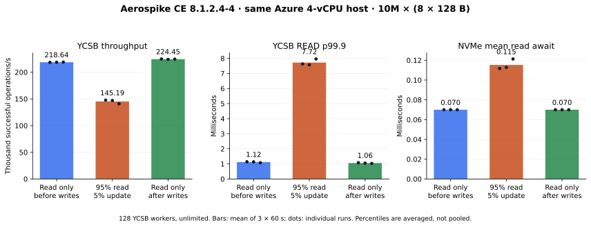

# 同机混合 I/O 排查与 Aerospike 验证

**已在 fio 和独立 SPDK 程序中复现慢读，问题不是 Lavik 独有。** 但还不能确定是物理 SSD、固件还是 Azure 虚拟化层的问题，也不能推广到所有同型号云主机。

独立 SPDK 程序不经过 Lavik、协程调度或文件系统：小块纯读三次平均 431,431 IOPS、0.297 ms；加入仅约 5 MiB/s 写入后，降到 71,640 IOPS、1.787 ms。慢的一轮仍高频轮询，没有超过 1 ms 的轮询间隔，因此不能用“Lavik 没及时轮询”解释这次复现。

Aerospike CE 8.1.2.4-4 在同一台 4 核机器、同一块 NVMe 上原生部署。1000 万条，8×128 字节，128 个 YCSB 工作线程，不限速，每点三次一分钟：

| 场景 | 平均 QPS | READ p99.9 | NVMe 平均读等待 |
|---|---:|---:|---:|
| 开启更新前纯读 | 218,644 | 1.120 ms | 0.070 ms |
| 95% 读／5% 更新 | 145,195 | 7.719 ms | 0.115 ms |
| 停止更新后纯读 | 224,445 | 1.056 ms | 0.070 ms |

混合负载吞吐下降 33.59%，READ p99.9 增至 6.89 倍；停止更新后恢复。9 个测量窗口均无客户端错误，服务端成功计数与客户端完全一致，defrag 读写计数均未增长。**Aerospike 也有明显的混合负载退化，但设备平均读等待没有达到 Lavik 那种持续约 1.6 ms 的程度，不能把它的全部吞吐下降和尾延迟都归因于盘。**

“都是聚合写”不等于磁盘请求相同：Aerospike 实际读约 1.625 KiB，应用刷盘单元默认 1 MiB，设备侧写平均 256 KiB；Lavik SPDK 先前读约 1.76 KiB、写约 53 KiB。Aerospike 的管理连接另计，实际观测最多 257 个总连接，不是只有 128 个 TCP 连接。其默认 `commit-to-device=false`，也不能视为与其他系统具有相同的同步持久化语义。

Dragonfly 的 1000 万条测试是纯内存模式。此前同机 1 亿条 tiering 测试实际读约 4 KiB、B 的写平均 4.73–4.86 KiB，与上述两者不同；它也出现过波动，只是没有观测到同等程度的持续慢读。

**不能宣称 4 KiB 对齐已经解决问题。** 独立 SPDK 的 4 KiB 对齐读加写三次均约 43.1 万 IOPS，但内核 fio 相同读对齐的一组三次为 43.1 万／8.6 万／8.5 万。反例全部保留，队列布局、写入历史和测试顺序仍可能影响结果；尚未部署或验证 Lavik 对齐补丁。

当前虚拟机能查到的盘型号是 **Microsoft NVMe Direct Disk v2**，固件 **NVMDV002**，容量约 **2.88 TB / 2.62 TiB**，PCI 厂商／设备 **1414:b111**。这是 Microsoft/Hyper-V 暴露的 NVMe 接口，不能据此识别底层物理 SSD 的品牌型号；需 Azure 侧查询。虚拟 SMART 没报介质错误，但累计读写计数仍为零，不能据此证明健康。

两台虚拟机均保留开机。Aerospike 测量后已正常停止，数据保留在原盘的 512 GiB 裸分区。

[完整方法、全部反例与复现步骤](README.md) · [Aerospike CSV](aerospike-results.csv) · [fio/SPDK CSV](io-results.csv) · [硬件识别记录](hardware.json) · [原始记录归档](raw.tar.xz) · [325 个原始文件的校验清单](manifest.json)
